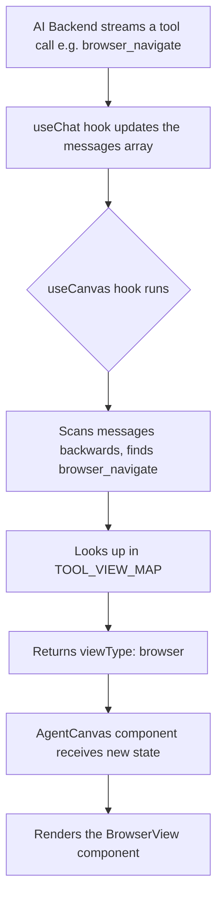
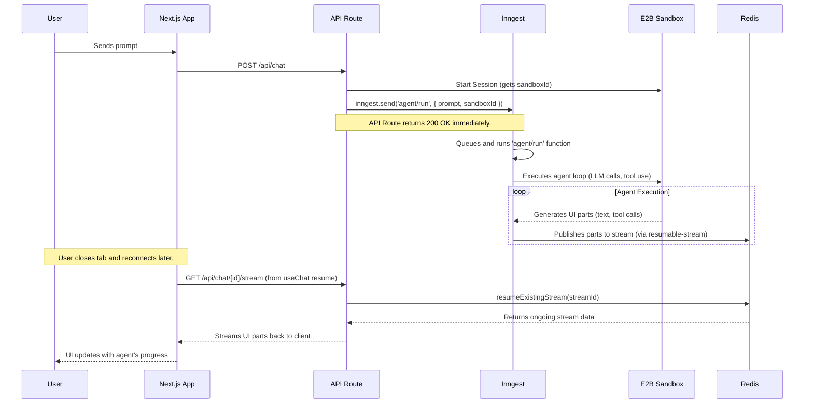

# Definitive Guide: Canvas Triggers & Resumable E2B Sessions

This document provides a comprehensive explanation of two core concepts:

1.  **The Reactive Canvas System**: Exactly which tools trigger which views in the canvas panel and the precise logic behind it.
2.  **Resilient Agent Sessions**: How to use resumable streams with E2B and a job queue (Inngest) so that your agent continues its work in the sandbox even if the user closes the browser tab, and how the UI seamlessly reconnects.

---

## Part 1: The Reactive Canvas — How Tools Open Views

The central insight is that the canvas is **not opened by `onClick` events**. It is a **reactive visualization** of the agent's most recent action, derived entirely from the `messages` array provided by the AI SDK's `useChat` hook.

### The `useCanvas` Hook: The Brains of the Operation

Your `use-canvas.ts` hook is the single source of truth for the canvas panel's state. Here is its exact logic:

1.  **Scan Backwards**: On every render (i.e., whenever `messages` changes), the hook iterates through the `messages` array in reverse.
2.  **Find Latest Tool**: It finds the most recent `tool-call` part within an assistant message.
3.  **Map Tool to View**: It uses a predefined mapping object, `TOOL_VIEW_MAP`, to look up the `viewType` associated with the tool's name.
4.  **Return State**: It returns a state object `{ isVisible, viewType, ...data }` that drives the entire canvas UI.

### The `TOOL_VIEW_MAP`: The Definitive Mapping

This object, located in your `use-canvas.ts`, is the exact logic that determines which view opens for which tool. Here is the complete mapping from your codebase:

| Tool(s) | `viewType` | Canvas View Opened |
| :--- | :--- | :--- |
| `browser_navigate`, `browser_view`, `browser_click`, `browser_input`, `browser_scroll`, `browser_move_mouse`, `browser_press_key`, `browser_select_option`, `browser_console_exec`, `browser_console_view`, `browser_screenshot`, `browser_restart`, `web_search`, `deploy_expose_port`, `deploy_apply_deployment`, `make_manus_page` | `"browser"` | **Browser View** (`BrowserView.tsx`) |
| `shell_exec`, `shell_view`, `shell_wait`, `shell_write_to_process`, `shell_kill_process`, `code_execute` | `"terminal"` | **Terminal View** (`TerminalView.tsx`) |
| `file_read`, `file_write`, `file_str_replace`, `file_find_in_content`, `file_find_by_name` | `"code"` | **Code IDE View** (`CodeIDEView.tsx`) |

Any tool not in this map will not trigger a canvas view.

### The Data Flow: From Stream to Canvas

The entire process is a one-way data flow, requiring no user clicks:



---

## Part 2: Resilient, Long-Running Agents (The E2B + Inngest + Redis Architecture)

You are correct: a truly autonomous agent must continue its work even if the user closes the tab. The standard AI SDK `resume` feature only works for the *UI stream*, not the backend compute. To solve this, you need to decouple the agent's long-running task from the HTTP request lifecycle.

Here is the production-grade architecture using E2B, Inngest, and Redis.

### The Architecture Components

1.  **E2B Sandbox**: The persistent environment where the agent's code (browser, shell, file I/O) actually runs. It has a session ID and can live for hours.
2.  **Next.js API Route (`/api/chat`)**: The **Controller**. It's responsible for starting the process but **not** for running it. It offloads the actual work to a background job queue.
3.  **Inngest**: The **Job Queue**. This is the core of the solution. It runs your agent logic as a background function, completely detached from the user's HTTP connection. This is what allows the agent to keep working after the tab is closed.
4.  **Redis**: The **Stream Store**. The Inngest function will publish the agent's progress (the `UIMessage` parts) to a Redis stream. This is what the `resumable-stream` package uses to allow the UI to reconnect.

### The Complete Lifecycle

This diagram shows how a user prompt triggers a long-running, resumable agent session.



### Implementation Steps

1.  **Modify your API Route (`/api/chat`)**: The `POST` handler should **not** call `streamText` directly. Instead, it should:
    *   Start an E2B sandbox session.
    *   Create a new chat session in your database.
    *   Call `inngest.send('agent/run', { data: { chatId, sandboxId, prompt } })`.
    *   Return an initial message to the user (e.g., "Got it, I'm on it.").

2.  **Create an Inngest Function (`inngest/agent.ts`)**: This is where your agent logic lives.

    ```typescript
    import { inngest } from "./client";
    import { streamText } from 'ai';
    import { createResumableStreamContext } from 'resumable-stream';
    // ... your agent logic

    export const runAgent = inngest.createFunction(
      { id: 'run-agent-session' },
      { event: 'agent/run' },
      async ({ event, step }) => {
        const { chatId, sandboxId, prompt } = event.data;

        // 1. Create the resumable stream context
        const streamContext = createResumableStreamContext();
        const streamId = generateId();
        await db.updateChat(chatId, { activeStreamId: streamId });

        // 2. Run the agent loop and stream results to Redis
        const llmStream = streamText({ model, messages, tools });
        const uiStream = llmStream.toUIMessageStream();

        // This pipes the UI stream to Redis via the resumable-stream package
        await streamContext.createNewResumableStream(streamId, () => uiStream);

        // 3. Clean up when done
        await db.updateChat(chatId, { activeStreamId: null });

        return { status: 'complete' };
      }
    );
    ```

3.  **Implement the GET Handler**: Your `GET /api/chat/[id]/stream` route remains the same as the AI SDK documentation. It reads the `activeStreamId` from your database and uses `streamContext.resumeExistingStream()` to pull from Redis.

By adopting this architecture, your agent's compute is no longer tied to the user's connection, achieving true persistence and resilience. The canvas will automatically reflect the agent's state upon reconnection because `useCanvas` is driven by the messages delivered from the resumed stream.
